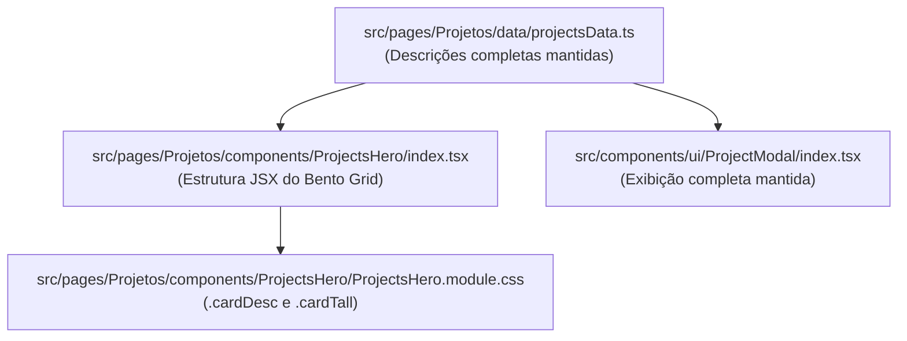

# Plano de Implementação: Truncamento Harmônico das Descrições no Bento Grid de Projetos

## 1. Visão Geral e Objetivo
Padronizar a diagramação visual das capas dos projetos na seção Bento Grid (`ProjectsHero`).
Atualmente, as descrições dos cards horizontais e panorâmicos se estendem em linhas excessivamente longas ou quebram em duas linhas deixando a segunda linha pela metade, gerando assimetria e diagramação pouco profissional.

### Decisões Alinhadas no `/grill-me`:
1. **Regra de 1 Linha com Reticências:** Aplicação de `-webkit-line-clamp: 1` e `text-overflow: ellipsis` em todos os cards do grid (inclusive verticais `cardTall`).
2. **Contenção de Largura (Max-Width):** Limitar a largura do texto com `max-width: 440px` (e `width: 100%`) em `.cardDesc`, impedindo que a linha cruze toda a extensão dos cards largos (`.cardWide` e `.cardFull`).
3. **Preservação Integral de Conteúdo:** O texto completo permanece inalterado na fonte de dados (`projectsData.ts`) e no modal de detalhes (`ProjectModal`).

---

## 2. Mapeamento de Dependências



---

## 3. Especificação Técnica das Mudanças

**Arquivo Alvo:** [`src/pages/Projetos/components/ProjectsHero/ProjectsHero.module.css`](file:///c:/Users/Andre/Documents/André/Antigravity/startmedia-nova_dimensao/site-ND/src/pages/Projetos/components/ProjectsHero/ProjectsHero.module.css)

### Modificação 1: Atualização de `.cardDesc`
```css
.cardDesc {
  font-family: var(--font-body);
  font-size: 13.5px;
  color: var(--color-gray-200);
  line-height: 1.45;
  margin-bottom: 0.85rem;
  max-width: 440px;
  width: 100%;
  display: -webkit-box;
  -webkit-line-clamp: 1;
  -webkit-box-orient: vertical;
  overflow: hidden;
  text-overflow: ellipsis;
}
```

### Modificação 2: Remoção do Override de Linhas em `.cardTall`
Remover a regra:
```css
.cardTall .cardDesc {
  -webkit-line-clamp: 3;
}
```
Isso garante a mesma harmonia de linha única compacta nos cards verticais de altura dupla.

---

## 4. Plano de Validação e Testes

1. **Inspeção Visual:**
   - Conferir cards horizontais (`cardStandard`), cards duplos (`cardWide`) e card full-width (`cardFull`).
   - Conferir cards verticais (`cardTall`).
2. **Responsividade:**
   - Testar em viewports de Desktop (1440px, 1200px), Tablet (768px) e Mobile (375px).
3. **Build e Tipagem:**
   - Rodar `npx tsc -b` e `npm run build` para garantir conformidade total sem erros.
